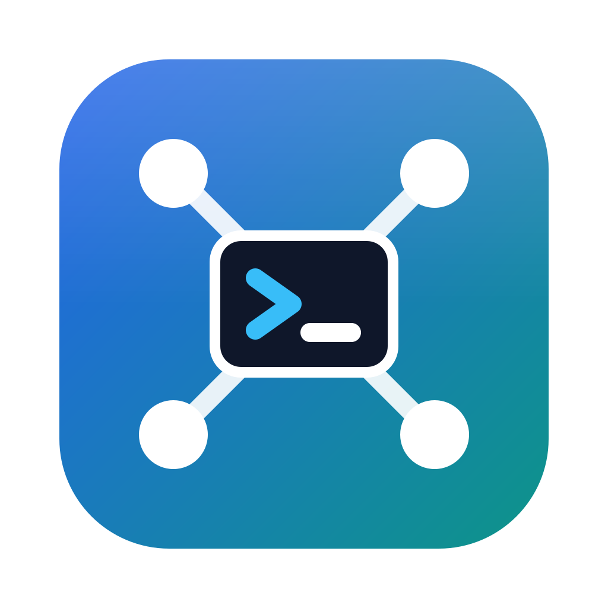

<p align="center"></p>

# ConMgr

Plattformübergreifender Verbindungsmanager (macOS, Linux, Windows) für **SSH, SFTP, RDP und VNC**, geschrieben in Rust mit [egui/eframe](https://github.com/emilk/egui). Oberfläche auf **Deutsch und Englisch**, hell, dunkel oder wie das Betriebssystem.

## Bauen & Starten

```bash
cargo run --release                     # Standard-Speicherort
cargo run --release -- ./meine.json     # eigene Verbindungsdatei
cargo test
```

### macOS: als App bauen

Unter macOS braucht ConMgr für Verbindungen ins lokale Netz die Berechtigung **„Lokales Netzwerk“**. Mit `cargo run` aus einem fremden Terminal (z. B. dem einer IDE) gilt dessen Berechtigung, und Verbindungen zu `192.168.x.x` scheitern mit „No route to host“. Deshalb als eigene App bauen und starten:

```bash
./scripts/bundle-macos.sh
open target/release/bundle/ConMgr.app
```

Beim ersten Verbinden fragt macOS einmal nach; die Freigabe lässt sich unter *Systemeinstellungen → Datenschutz & Sicherheit → Lokales Netzwerk* ändern.

Damit die Freigabe über Neubauten erhalten bleibt, einmalig ein lokales Signatur-Zertifikat anlegen (selbst signiert, nur für `codesign`, im Anmelde-Schlüsselbund):

```bash
./scripts/create-signing-cert-macos.sh
```

`bundle-macos.sh` signiert dann damit; ohne Zertifikat signiert es ad-hoc, und macOS verwirft die Freigabe bei jedem Neubau.

### Logo

`assets/logo.svg` ist die einzige Quelle: Die App zeigt es auf dem Sperrbildschirm und als Hintergrund, solange keine Sitzung offen ist, und erzeugt daraus das Fenster-Icon. `bundle-macos.sh` rendert es mit `cargo run --example render_icon` in ein Iconset und baut daraus `AppIcon.icns`.

## Verbindungsdatei

Standardpfad:

| OS      | Pfad |
|---------|------|
| macOS   | `~/Library/Application Support/ConMgr/connections.json` |
| Linux   | `~/.config/conmgr/connections.json` |
| Windows | `%APPDATA%\ConMgr\config\connections.json` |

Lesbares JSON – nur Passwörter, Schlüssel und Passphrasen sind verschlüsselt. Die Einträge bilden einen Baum aus Ordnern, Verbindungen und Zugangsdaten (Format 2; Dateien im alten Format 1 werden beim Öffnen automatisch übernommen):

```json
{
  "version": 2,
  "kdf": { "algorithm": "argon2id", "salt": "…", "m_cost": 19456, "t_cost": 2, "p_cost": 1 },
  "verifier": { "nonce": "…", "data": "…" },
  "items": [
    { "type": "folder", "id": "…", "name": "Credentials", "expanded": true, "children": [
      { "type": "credential", "id": "c1", "name": "Personal Admin", "username": "admin",
        "password": { "nonce": "…", "data": "…" } }
    ]},
    { "type": "folder", "id": "f1", "name": "Production", "color": "#e53935", "credential_id": "c1",
      "expanded": true, "children": [
      { "type": "connection", "id": "…", "name": "web01 - SSH", "host": "10.0.0.5", "port": 22,
        "protocol": "ssh", "credentials": { "mode": "inherit" }, "favorite": true }
    ]}
  ]
}
```

## Bedienung

- **Baum** links: **Ein Klick auf eine Verbindung verbindet** – ist schon ein Tab offen, wechselt ConMgr dorthin („Weitere Sitzung öffnen“ im Kontextmenü öffnet eine zusätzliche). **Rechtsklick** öffnet das Kontextmenü mit Eigenschaften, Duplizieren, Exportieren und Löschen. Ein Klick auf Ordner oder Zugangsdaten markiert nur; der **Eigenschaften-Tab** öffnet sich ausschließlich über „📝 Eigenschaften“ (oder beim Anlegen) und lässt sich mit ✖ schließen. Ordner per Doppelklick auf-/zuklappen, Einträge per **Ziehen & Ablegen** verschieben (auf einen Ordner = hinein, auf einen Eintrag = davor, auf die freie Fläche = oberste Ebene).
- **📌 Fixieren / automatisch ausblenden:** Nicht fixiert bleibt nur eine schmale Leiste (»); fährt die Maus darüber, schwebt der Baum über dem Inhalt ein und verschwindet beim Verlassen wieder – die Sitzung behält ihre Größe. Die Einstellung wird gespeichert.
- **Löschen** fragt in einem Dialog nach; **Entf** (Mac: ⌘⌫) löscht den markierten Eintrag.
- Die Statuszeile unten zeigt den Zustand der zuletzt gestarteten Verbindung und leert sich, wenn sie endet.
- **Zugangsdaten** sind eigene Einträge mit Benutzer, Passwort und optional **privatem SSH-Schlüssel samt Passphrase** (aus Datei laden oder einfügen; Fingerabdruck und „Öffentlichen Schlüssel kopieren“). Eine Verbindung nutzt *eigene* Zugangsdaten, *bestimmte* gespeicherte oder *erbt* sie vom nächsten übergeordneten Ordner mit Zugangsdaten.
- **Icons & Farben** pro Eintrag, **Favoriten** (⭐) mit Filter, **Suche** über Name, Host und Benutzer.
- **Duplizieren** kopiert Einträge und ganze Ordner; Verweise auf mitkopierte Zugangsdaten zeigen danach auf die Kopien.
- **Menü ☰:** *Master-Passwort ändern* (neues Salt, alle Geheimnisse umverschlüsselt), *Alles exportieren*, *Importieren*. Einzelne Einträge/Ordner exportiert das Kontextmenü. Exporte sind eigene, mit einem **eigenen Passwort** geschützte Dateien – gut zum Weitergeben. Importe landen in einem neuen Ordner „Import …“.
- `⌘S` / `Strg+S` speichert den offenen Eintrag.
- **⚙ Einstellungen** (Menü ☰): Sprache (wie System, Deutsch, English) und Darstellung (wie System, Hell, Dunkel). Änderungen wirken sofort und werden in der Verbindungsdatei gespeichert – auch der Sperrbildschirm erscheint danach in Sprache und Design.

## Sitzungen in Tabs

Ein Doppelklick öffnet SSH, SFTP, RDP und VNC als Tab direkt in ConMgr. „Extern“ bzw. das Kontextmenü startet stattdessen das Programm des Betriebssystems.

### SSH-Terminal

Eingebautes Terminal (`xterm-256color`, 256 Farben/Truecolor). Markieren mit der Maus und `⌘C` kopiert, `⌘V` fügt ein (unter Windows/Linux `Strg+C` ohne Markierung = Abbruch-Signal). Mausrad blättert im Verlauf (5000 Zeilen); die Größe folgt dem Fenster.

**Anmeldung** in dieser Reihenfolge:
1. privater Schlüssel aus den Zugangsdaten,
2. **SSH-Agent** (`SSH_AUTH_SOCK`; unter Windows OpenSSH-Agent und Pageant),
3. Standardschlüssel `~/.ssh/id_ed25519`, `id_ecdsa`, `id_rsa`,
4. Passwort, dann Keyboard-Interactive.

Fehlt eine **Passphrase** oder ein Passwort – oder wird das gespeicherte abgelehnt –, fragt ConMgr im Tab nach. Akzeptiert der Server nur Schlüssel, gibt es eine klare Meldung statt einer Passwortabfrage.

**Host-Keys** werden gegen `~/.ssh/known_hosts` geprüft (dieselbe Datei wie OpenSSH). Unbekannte Keys zeigt ConMgr mit Fingerabdruck zur Bestätigung an; **geänderte Keys werden immer abgelehnt**.

### SFTP-Browser

Für SFTP-Verbindungen per Doppelklick, für SSH-Verbindungen über „📂 SFTP“. Gleiche Anmeldung wie das Terminal. Pfadleiste, Home, Aktualisieren; Doppelklick öffnet Ordner bzw. lädt Dateien herunter. **Hochladen** per Knopf oder **Drag & Drop aus Finder/Explorer**, Übertragungen mit Fortschritt laufen nebenher. Neuer Ordner, Umbenennen, Löschen (Ordner nur, wenn leer).

### RDP

Über [IronRDP](https://github.com/Devolutions/IronRDP): TLS mit **NLA** (CredSSP/NTLM), Desktop in Tab-Größe (physische Pixel; auf Retina-Displays meldet ConMgr Windows die passende Skalierung, z. B. 200 %). Maus inkl. Rad, Tastatur: Text geht als Unicode an den Server und ist damit unabhängig vom Tastaturlayout; Sondertasten und Kürzel als Scancodes (unter macOS wird ⌘ zu Strg, also ⌘C/⌘X/⌘V wie gewohnt).

- **Größe:** Ändert sich der Tab (Fenster, Seitenleiste), passt sich der Windows-Desktop nach einer halben Sekunde Ruhe an (Display-Control-Kanal).
- **Zwischenablage:** Text in beide Richtungen. In Windows Kopiertes landet in der Mac-Zwischenablage; auf dem Mac Kopiertes steht in Windows zum Einfügen bereit. Hinweis: Wie bei mstsc sieht der Server dabei alles, was du lokal kopierst, solange der Tab verbunden ist.

Anmeldung: Benutzer als `benutzer`, `DOMÄNE\benutzer` oder `benutzer@domäne`; fehlen Benutzer oder Passwort, fragt der Tab nach.

**Zertifikate:** RDP-Server haben meist selbst signierte Zertifikate. Lässt sich das Zertifikat nicht prüfen, zeigt ConMgr den SHA-256-Fingerabdruck zur Bestätigung und merkt ihn sich in `rdp_certificates.json` (neben der Verbindungsdatei). **Ein geändertes Zertifikat wird abgelehnt** – Eintrag dort löschen, wenn der Server bewusst ein neues bekommen hat.

Noch nicht: Kerberos, Smartcards, Sound, Laufwerksumleitung, Dateien/Bilder in der Zwischenablage, RD-Gateway.

### VNC

Bild wird ins Fenster eingepasst; Maus (inkl. Rad) und Tastatur werden weitergegeben, `⌘V`/`Strg+V` tippt den Text der Zwischenablage auf der Gegenseite. Text aus der Zwischenablage des Servers wird übernommen. Kodierungen: ZRLE, CopyRect, Raw.

Anmeldung: klassisches **VNC-Passwort** (aus den Zugangsdaten oder per Abfrage). Die macOS-Bildschirmfreigabe verlangt standardmäßig Apple-Anmeldung (ARD), die nicht unterstützt wird – dort *„VNC-Benutzer dürfen den Bildschirm mit Passwort steuern“* aktivieren oder extern öffnen.

Beendete Sitzungen lassen sich im Tab neu verbinden. **Sperren trennt alle Sitzungen.**

### Tests gegen echte Server

Die mit `#[ignore]` markierten Tests laufen gegen einen echten sshd. `HOME` muss auf ein Testverzeichnis zeigen (Schlüssel in `.ssh`, `known_hosts` wird dort angelegt; für den Passphrase-Test zusätzlich `enc_key` mit Passphrase `geheim123`):

```bash
CONMGR_E2E_SSH_PORT=2222 HOME=/pfad/zum/test-home cargo test e2e -- --ignored --test-threads=1
```

Der VNC-Test (eigener minimaler RFB-Server) und der RDP-Zertifikatstest (eigener Server bis einschließlich TLS) laufen bei `cargo test` immer.

## Verschlüsselung

- Aus dem **Master-Passwort** wird per **Argon2id** (zufälliges Salt) ein 256-Bit-Schlüssel abgeleitet.
- Jedes Geheimnis (Passwort, privater Schlüssel, Passphrase) wird einzeln mit **AES-256-GCM** und eigener Zufalls-Nonce verschlüsselt. Associated Data ist die ID des Eintrags plus das Feld – Chiffrate lassen sich weder zwischen Einträgen noch zwischen Feldern vertauschen.
- `verifier` ist ein verschlüsselter bekannter Text, mit dem das Master-Passwort beim Entsperren geprüft wird.
- Der Schlüssel liegt nur im Speicher und wird beim Sperren/Beenden genullt. Die Datei wird atomar und (Unix) mit Rechten `0600` geschrieben.

## Externe Clients

Über „Extern“ (bei RDP immer) startet ConMgr die Clients des Betriebssystems:

| Typ  | macOS | Linux | Windows |
|------|-------|-------|---------|
| SSH  | `ssh` in Terminal.app | `ssh` im Terminal-Emulator | `ssh` (OpenSSH-Client) |
| SFTP | `sftp` in Terminal.app | `sftp` im Terminal-Emulator | `sftp` |
| RDP  | `.rdp`-Datei → „Windows App“ | `xfreerdp3`/`xfreerdp` (mit Passwort) | `mstsc` (Passwort via `cmdkey`) |
| VNC  | Bildschirmfreigabe (`vnc://`) | `vncviewer` | `vncviewer` (TigerVNC) |

**SSH/SFTP:** ConMgr übergibt das Passwort über `SSH_ASKPASS` (OpenSSH ≥ 8.4). Die App vergibt pro Verbindung ein einmaliges, 2 Minuten gültiges Token und liefert das Passwort über einen nur lokal erreichbaren Socket (127.0.0.1) an ssh – es steht weder auf der Kommandozeile noch in einer Datei. Andere Rückfragen (Host-Key bestätigen, Schlüssel-Passphrase, erneute Eingabe nach falschem Passwort) erscheinen ganz normal im Terminal.

Wo der Client kein Passwort übernehmen kann (VNC, RDP unter macOS), kopiert ConMgr es beim Verbinden in die Zwischenablage und löscht es dort nach 30 Sekunden wieder.

Hinweis Windows/RDP: `cmdkey` legt die Anmeldedaten dauerhaft in der Windows-Anmeldeinformationsverwaltung ab.
